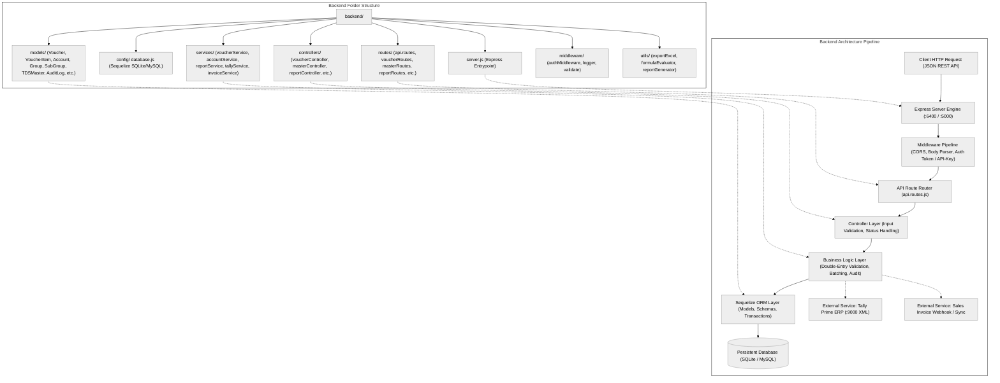
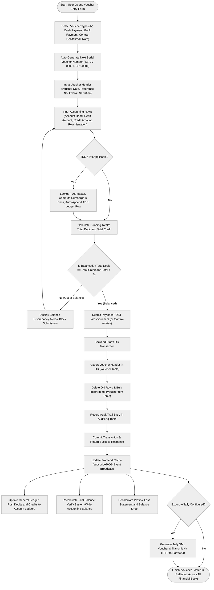
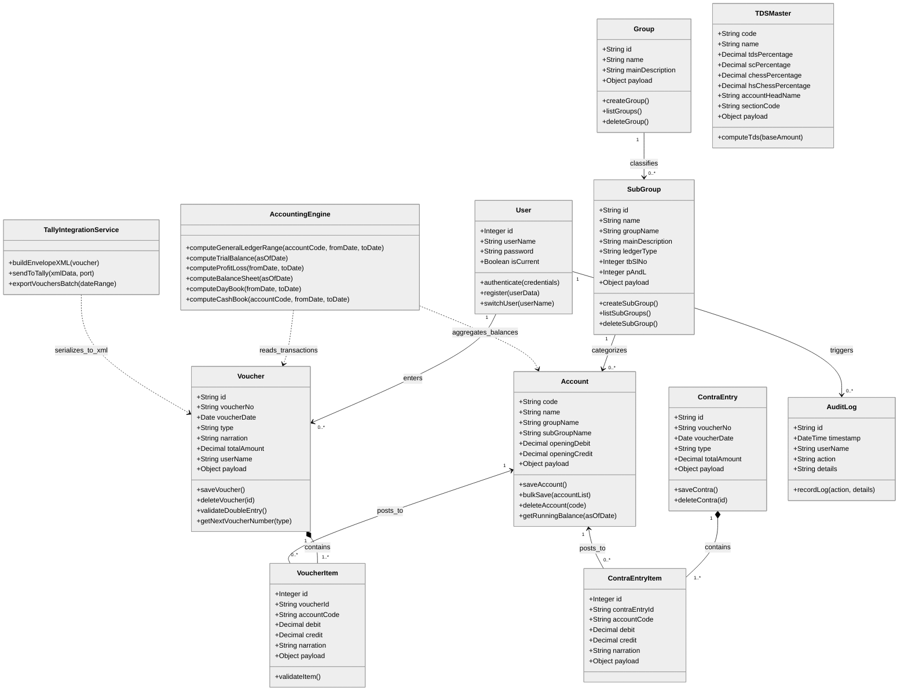
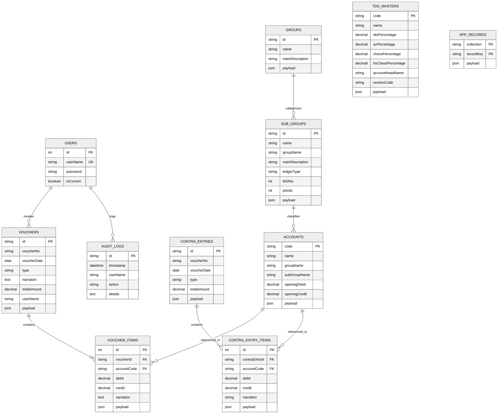

# KR Accounts ERP — System Architecture & Workflows (Black & White)

This document provides complete, high-fidelity architectural documentation and Black & White (B&W) diagrams for the **Mill Accounts Management System (KR Accounts ERP)**.

---

## 1. Backend Folder & Architectural Flowchart (Black & White)

---

## 2. Frontend Folder & Module Architecture (Black & White)

```mermaid
%%{init: {'theme': 'neutral', 'themeVariables': { 'primaryColor': '#ffffff', 'primaryBorderColor': '#000000', 'primaryTextColor': '#000000', 'lineColor': '#000000', 'secondaryColor': '#f5f5f5', 'tertiaryColor': '#ffffff', 'clusterBkg': '#ffffff', 'clusterBorder': '#000000' }}}%%
flowchart TD
    subgraph FF["Frontend Folder Structure"]
        direction TB
        F_SRC["frontend/src/"]
        F_ENTRY["main.jsx / App.jsx (Root & Theme Setup)"]
        F_ROUTES["routes/ AppRoutes.jsx (Route Definitions)"]
        F_LAYOUTS["layouts/ (MainLayout, AuthLayout)"]
        F_PAGES["pages/ (Dashboard, Vouchers, Masters, Reports, Settings, Login)"]
        F_VOUCHERS["components/vouchers/ (Journal, CashPayment, BankPayment, Contra, Notes)"]
        F_MASTERS["components/masters/ (AccountMaster, GroupMaster, SubGroupMaster, TDSMaster)"]
        F_REPORTS["components/reports/ (DayBook, CashBook, GeneralLedger, TrialBalance, ProfitLoss, BalanceSheet)"]
        F_COMMON["components/common/ (Sidebar, Navbar, DataTable, DateFilter, SearchPanel, ExcelImport)"]
        F_DB["database.js (Optimistic Client Cache & Accounting Calculation Engine)"]
        F_API["api/ (axios.js, voucherApi, masterApi, reportApi, authApi)"]

        F_SRC --> F_ENTRY
        F_SRC --> F_ROUTES
        F_SRC --> F_LAYOUTS
        F_SRC --> F_PAGES
        F_SRC --> F_VOUCHERS
        F_SRC --> F_MASTERS
        F_SRC --> F_REPORTS
        F_SRC --> F_COMMON
        F_SRC --> F_DB
        F_SRC --> F_API
    end

    subgraph FA["Frontend Module Architecture"]
        direction TB
        USER_ACT["User Action (Voucher Entry, Report Filter, Master Setup)"]
        VIEW_UI["React View Layer (Tailwind CSS, Data Grids, Forms, Modals)"]
        ROUTING["React Router DOM (Protected & Public Navigation)"]
        STATE_STORE["State Management (AuthContext & subscribeToDB Reactive Bus)"]
        CALC_ENGINE["Financial Logic Engine (Trial Balance, P&L, Ledger, DayBook Calculations)"]
        API_LAYER["API Service Layer (Axios HTTP Client with Interceptors)"]
        BACKEND_TARGET["Backend REST Endpoints (/ams/*)"]

        USER_ACT --> VIEW_UI
        VIEW_UI --> ROUTING
        VIEW_UI --> STATE_STORE
        STATE_STORE --> CALC_ENGINE
        STATE_STORE --> API_LAYER
        API_LAYER --> BACKEND_TARGET
        BACKEND_TARGET -. Sync Data .-> STATE_STORE
    end

    F_ROUTES -.-> ROUTING
    F_VOUCHERS -.-> VIEW_UI
    F_REPORTS -.-> VIEW_UI
    F_DB -.-> STATE_STORE
    F_DB -.-> CALC_ENGINE
    F_API -.-> API_LAYER
```

---

## 3. Double-Entry Voucher Processing Workflow (Black & White)

---

## 4. Class Diagram of Mill Account Management System (Black & White)

---

## 5. Entity-Relationship (ER) Diagram of KR Accounts ERP (Black & White)

